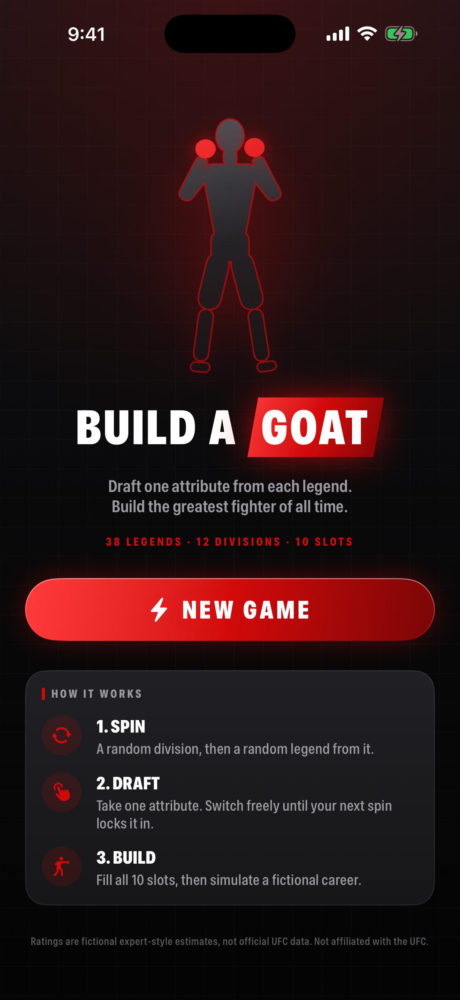
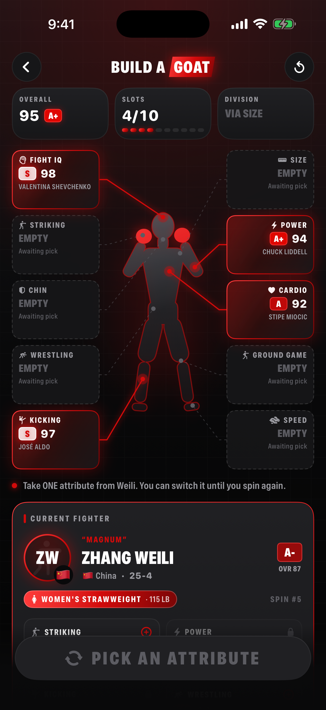
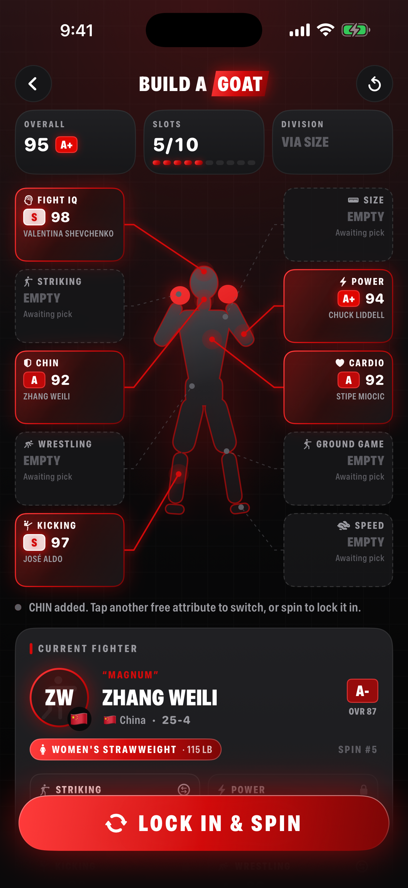
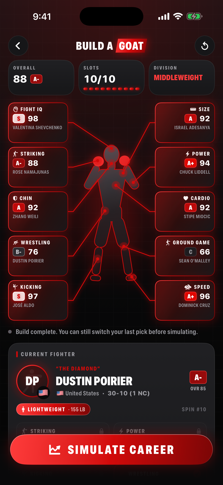
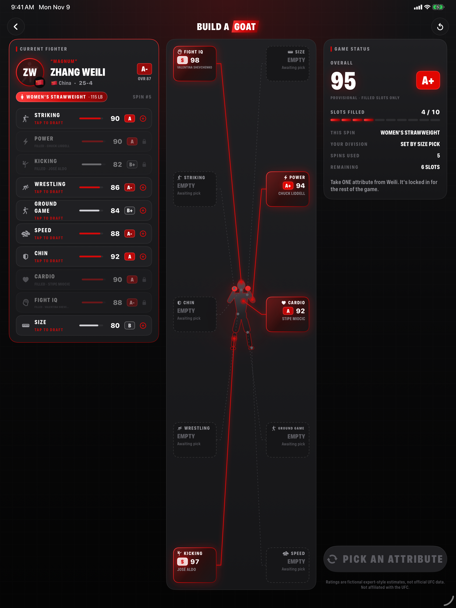

<div align="center">

# BUILD A GOAT

**Draft one attribute from each MMA legend. Build the greatest fighter of all time.**

A native iOS game built with **Swift 6 · SwiftUI · Clean Architecture**

[](https://github.com/OkonovUrmat/build-a-ufc-fighter/actions/workflows/ci.yml)


🇷🇺 [Русская версия / заметки разработчика](README.ru.md)

</div>

---

## Screenshots

> Captured automatically on every push by [GitHub Actions](.github/workflows/ci.yml) from the iOS Simulator, using the app's deterministic demo scenes.

| Home | Drafting | Switching a pick | Build complete |
|:---:|:---:|:---:|:---:|
|  |  |  |  |

**iPad: three-panel dashboard layout**



---

## The game

1. **Spin.** A random UFC division is drawn, then a random legend from it. All 12 men's and women's divisions are covered.
2. **Draft.** Take exactly **one** of that fighter's ten rated attributes: Striking, Power, Kicking, Wrestling, Ground Game, Speed, Chin, Cardio, Fight IQ, Size.
3. **Lock in.** Mis-tapped? Switch to any other free slot until you spin again. Spinning locks the pick permanently.
4. **Build.** Fill all ten slots around the fighter silhouette, then simulate a career *(Phase 3)*.

Strategy matters. Your fighter's **weight class comes from whoever you took SIZE from**. The **overall rating punishes holes**: an elite striker with a glass chin gets found out.

---

## Engineering highlights

### Clean Architecture in Swift packages

```
BuildAGoat (app target) ── composition root, wires Data → Presentation
└── Packages/BuildAGoatKit
    ├── GoatDomain        Pure Swift: models, rules, rating math, seeded RNG, game engine
    ├── GoatData          Fighter catalog + repository (SwiftData-backed in Phase 2)
    └── GoatPresentation  SwiftUI design system, screens, @Observable view models
```

- **Dependency rule enforced by the package graph.** `GoatPresentation` depends only on `GoatDomain` and never sees `GoatData`. The concrete repository is injected by the app target.
- **The domain imports no UI frameworks.** All game rules live in a value-type `GameEngine` and are unit-tested without SwiftUI or a simulator.

### Game logic you can reason about

- **Explicit state machine.** `GameSession.Phase` (`readyToSpin → awaitingSelection → complete`) drives both the rules and the UI. Illegal moves throw typed `GameError`s instead of relying on disabled buttons.
- **Deterministic randomness.** A SplitMix64 `SeededRandomNumberGenerator` with its own bounded sampling, so the same seed replays the same game on every toolchain. This makes randomness testable, and CI uses it to render identical screenshots on every run.
- **Weighted overall rating with a weakness penalty.** Weights are configurable and validated (they must cover every attribute and sum to 100%). Attributes below 70 subtract points in proportion to their weight, so the score isn't a naive average.
- **Provenance.** Every `AttributeSelection` keeps its source fighter ID, name, division and spin number, so the final build can show where each attribute came from.

### Swift 6 & modern SwiftUI

- **Strict concurrency.** Swift 6 language mode; all domain types are `Sendable`, and view models are `@MainActor @Observable`.
- **iOS 17 APIs.** `phaseAnimator` (slot "pop"), `sensoryFeedback` (haptics on reel ticks, reveals and picks), `symbolEffect`, `contentTransition(.numericText())`, `Path.union` (the silhouette is built from unioned vector primitives, so it has a single clean outline).
- **Custom vector silhouette and connector lines.** Body, gloves and attribute anchor points share a 100×200 unit coordinate space. Red connector lines animate in with `trim` as slots fill.
- **Adaptive layout.** A single-column flow on iPhone and a three-panel dashboard (current fighter · build board · game status) on iPad and wide screens.
- **Accessibility.** VoiceOver labels and hints on interactive controls; the reel animation respects *Reduce Motion*.

### Tested & automated

- **Swift Testing suite** covering:
  - tier boundaries;
  - weight validation and rating math;
  - RNG determinism and division coverage;
  - every game rule: one pick per spin, switching, locking, completion, replay by seed;
  - dataset integrity.
- **GitHub Actions on `macos-15`**: runs the tests, builds the app, boots iPhone and iPad simulators, captures the screenshots above and commits them back to the repository.

---

## Run it

Requires **Xcode 16+**.

```bash
git clone https://github.com/OkonovUrmat/build-a-ufc-fighter.git
open build-a-ufc-fighter/BuildAGoat.xcodeproj   # then ⌘R
```

Domain tests: open `Packages/BuildAGoatKit/Package.swift` and press ⌘U.

Demo scenes for quick review: add the launch argument `-demoScene <home|builder|drafting|switching|complete|summary>`. It is pre-configured (disabled) in the shared scheme.

---

## Roadmap

| Phase | Scope | Status |
|---|---|---|
| 1 | Architecture, design system, Fighter Builder, spin & draft loop | ✅ |
| 2 | Expanded fighter database, SwiftData persistence, rating refinements | ⏳ |
| 3 | Career simulation, Fighter DNA (similarity), GOAT ranking | ⏳ |
| 4 | Result screen, shareable Instagram Story card (`ImageRenderer` + `ShareLink`), polish | ⏳ |

---

## Disclaimer

Fan project for portfolio purposes; **not affiliated with or endorsed by the UFC**. Attribute ratings are subjective, expert-style estimates of each fighter's peak, not official data. Professional records are approximate. All generated careers and rankings are fictional simulations. Fighter portraits are monogram placeholders.
